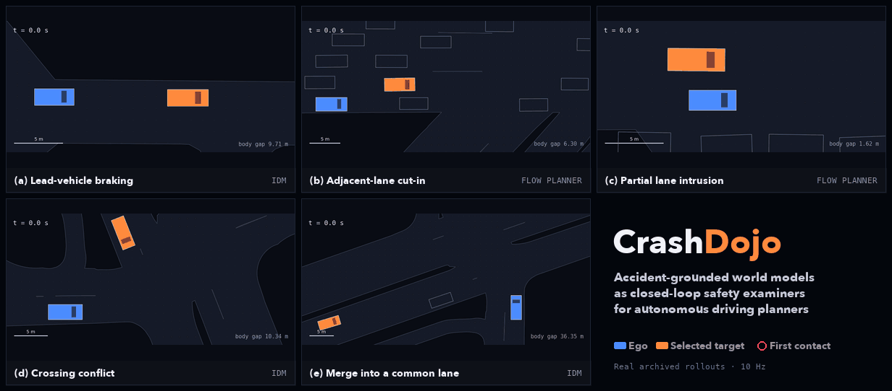

<div align="center">

# CrashDojo

### Accident-Grounded World Models as Closed-Loop Safety Examiners for Autonomous Driving Planners

Bowen Jing<sup>1,*</sup>, Haoyun Tang<sup>2,*</sup>, Ruiyang Hao<sup>3</sup>, Chenchen Ge<sup>4</sup>, Weitao Zhou<sup>5</sup>, Haibao Yu<sup>6,†</sup>

<sup>1</sup> Tuojing AI, <sup>2</sup> Xi'an Jiaotong University, <sup>3</sup> King's College London<br>
<sup>4</sup> Southeast University, <sup>5</sup> Beijing Simple AI Technology, <sup>6</sup> The University of Hong Kong<br>
<sup>*</sup> Equal contribution &nbsp; <sup>†</sup> Corresponding author

[](https://crashdojo.github.io)
[](#license)

</div>

## News

- **Nov. 2026:** The [project page](https://crashdojo.github.io) and code are released.

## Overview

CrashDojo maps road and participant context to an accident-informed
actor–mechanism request and steers a frozen traffic world model toward it.
Each closed-loop planner challenge therefore records who acts, which maneuver
is requested, and which variables are controlled, so a planner failure can be
traced to a specific accident mechanism rather than to an unexplained
adversarial rollout.

<div align="center">

</div>

<div align="center">

</div>

This repository includes:

- the CrashDojo generator built on CCDiff: actor selection, mechanism
  guidance and the planner interfaces (`ccdiff/`);
- the training launcher and the registered flow-matching and diffusion
  configurations;
- the preserved runners for the main nuScenes and nuPlan evaluations, the
  baselines and the component ablations (`experiments/`);
- the request-realization scorer (`analysis/`);
- scripts that recompute the supplementary summary tables from the paper's
  own tables (`paper_summaries/`);
- the vendored tbsim runtime, the SAFE-SIM baseline and the tuplan_garage
  rule-based planner integration;
- unit tests for the request loader, the runtime contract, the ablation
  arms and the training launcher.

Model weights and datasets are not included.

## Installation

### 1. System requirements

The reference environment was developed for:

- Linux x86-64;
- an NVIDIA GPU and a driver compatible with CUDA 11.7;
- Git and Conda/Miniconda;
- Python 3.8;
- PyTorch 1.13.1 and torchvision 0.14.1.

CPU-only execution has not been validated and is not recommended for training
or closed-loop evaluation.

### 2. Clone the repository

```bash
git clone https://github.com/HaoyunT/CrashDojo.git
cd CrashDojo
```

### 3. Create the Conda environment

```bash
conda env create -f environment.yml
conda activate crashdojo
```

Confirm that PyTorch can see the GPU:

```bash
python -c "import torch; print('torch:', torch.__version__); print('cuda:', torch.cuda.is_available())"
```

The expected output contains `torch: 1.13.1` and `cuda: True`.

### 4. Install CrashDojo and pinned third-party dependencies

Run the bootstrap script from the repository root:

```bash
bash scripts/bootstrap_third_party.sh
```

The script:

1. clones the research-compatible trajdata fork at revision
   `79ea54ce36d8b2b09b4bb4b43579ef2520352158`;
2. clones NVIDIA spline-planner at revision
   `c3d172917f337531209149546670503fa8ed1d3c`;
3. installs trajdata, spline-planner, the vendored tbsim runtime and
   CrashDojo in editable mode.

The checkouts are placed under `third_party/` and ignored by Git. Set
`TRAJDATA_REVISION` or `PPLAN_REVISION` to use other revisions. The SAFE-SIM
baseline ships its own `tbsim` package; install it in a separate environment
as described in [baselines/safe_sim/README.md](baselines/safe_sim/README.md).

### 5. Prepare the datasets

Download nuScenes `v1.0-trainval` (metadata, samples, sweeps and maps):

```text
/path/to/nuscenes/
├── maps/
├── samples/
├── sweeps/
└── v1.0-trainval/
```

```bash
export NUSCENES_ROOT=/path/to/nuscenes
export TRAJDATA_CACHE_DIR=/path/to/trajdata_cache
mkdir -p "$TRAJDATA_CACHE_DIR"
```

The first dataset access builds the trajdata cache and may take a while. The
nuPlan evaluation additionally needs the nuPlan dataset and devkit, obtained
under their own terms. Each external ego planner and its checkpoint must be
installed separately; see [docs/EVALUATION.md](docs/EVALUATION.md).

### 6. Point the preserved runners at your machine

The evaluation and ablation runners are kept as they were run for the paper,
with machine paths replaced by placeholders such as `/path/to/workspace`.
Set your own locations and rewrite the placeholders:

```bash
export CRASHDOJO_WORKSPACE=/path/to/crashdojo_workspace   # project and checkpoints
export CRASHDOJO_STORAGE=/path/to/crashdojo_storage       # shared outputs
export CRASHDOJO_LOCAL=/path/to/local_scratch             # per-host logs
export CRASHDOJO_PYTHON="$(which python)"                 # generator interpreter
export CRASHDOJO_SAFESIM_PYTHON=/path/to/safesim/bin/python

python scripts/localize_paths.py            # preview the replacements
python scripts/localize_paths.py --apply    # rewrite the files
```

Unset variables leave their placeholders unchanged. Documentation files are
not rewritten.

### 7. Verify the installation

```bash
python -c "import ccdiff, tbsim, trajdata; print('CrashDojo imports: OK')"
python -m unittest discover -s tests -v
```

All tests should pass in the reference environment.

## Training

After setting `NUSCENES_ROOT`, train the flow-matching world model with:

```bash
bash scripts/run_train.sh
```

Optional settings are read from environment variables, and extra arguments
are passed to [scripts/train.py](scripts/train.py):

```bash
export CRASHDOJO_RUN_NAME=crashdojo_flow
export CRASHDOJO_OUTPUT_DIR=/path/to/runs
export CRASHDOJO_GPUS=4
export CRASHDOJO_STEPS=100000
bash scripts/run_train.sh --dry-run        # print the command only
bash scripts/run_train.sh --smoke-steps 5  # short check
bash scripts/run_train.sh
```

Set `CRASHDOJO_CONFIG=trajdata_nusc_ccdiff` for the diffusion variant and
`CRASHDOJO_RESUME=/path/to/last.ckpt` to resume. See
[docs/TRAINING.md](docs/TRAINING.md) for details.

## Closed-loop evaluation and ablations

List the preserved suites:

```bash
python scripts/experiment.py --list
```

| Suite | Runs |
|---|---|
| `main_nuscenes`, `main_nuplan` | CrashDojo against the evaluated planners |
| `baselines_part1`, `baselines_part2` | Baseline generators |
| `ablation_seed1`, `ablation_seeds23` | Component ablations (Full, A1–A4) |

Run a suite; arguments after the script are passed unchanged to its runner:

```bash
export CRASHDOJO_SUITE=main_nuscenes
CRASHDOJO_DRY_RUN=1 bash scripts/run_eval.sh --job-id JOB_ID   # print the command only
bash scripts/run_eval.sh --job-id JOB_ID
```

The runners need datasets, checkpoints, planner packages and request
manifests. See [docs/EVALUATION.md](docs/EVALUATION.md) and
[docs/ABLATIONS.md](docs/ABLATIONS.md); the
[paper implementation map](docs/PAPER_IMPLEMENTATION.md) locates the code
paths behind each component of the paper, and the
[VLM notes](docs/VLM_ASSESSMENT.md) describe the supplementary plausibility
screen.

## Paper summary scripts

`paper_summaries/` recomputes two supplementary quantities from the paper's
own tables, with no GPU, data or network:

```bash
cd paper_summaries
python analysis/seed_summary_bounds.py     # Supplementary Table 12
python analysis/contact_count_ranges.py    # overlap ranges in Appendix D
```

## Repository structure

```text
ccdiff/                   generator, actor selection, mechanism guidance, planner interfaces
third_party/tbsim/        vendored traffic simulation runtime
baselines/safe_sim/       SAFE-SIM baseline
planners/tuplan_garage/   rule-based planner integration
configs/                  experiment catalog and archived development contract
experiments/main/         main nuScenes and nuPlan evaluation, baseline adapters
experiments/ablations/    component ablations
experiments/support/      shared runtime helpers
analysis/                 request-realization scorer
paper_summaries/          scripts for the supplementary summary tables
scripts/                  installation, training, evaluation and path helpers
tests/                    unit tests
docs/                     training, evaluation and ablation guides
```

The internal package keeps the name `ccdiff` for import and checkpoint
compatibility.

## License

This is a mixed-license repository. CrashDojo and inherited CCDiff code are
distributed under Apache-2.0 ([LICENSE](LICENSE)). The SAFE-SIM baseline
(`baselines/safe_sim/`) and the vendored CCFM planner code
(`ccdiff/planners/vendor/`) are under CC BY-NC 4.0 and restricted to
non-commercial use; `planners/tuplan_garage/` keeps its own license. Files
inherited from NVIDIA traffic-behavior-simulation keep their notices. Read
[NOTICE](NOTICE), [THIRD_PARTY_NOTICES.md](THIRD_PARTY_NOTICES.md) and
[LICENSES/](LICENSES/) before redistribution or use.

## Citation

If you find CrashDojo useful, please cite:

```bibtex
@misc{jing2026crashdojo,
  title={CrashDojo: Accident-Grounded World Models as Closed-Loop Safety Examiners for Autonomous Driving Planners},
  author={Jing, Bowen and Tang, Haoyun and Hao, Ruiyang and Ge, Chenchen and Zhou, Weitao and Yu, Haibao},
  year={2026},
  howpublished={\url{https://crashdojo.github.io}}
}
```

## Acknowledgements

CrashDojo builds on
[CCDiff](https://github.com/cruise-automation/CCDiff),
[SAFE-SIM](https://github.com/jxmmy7777/safe-sim),
[CCFM](https://github.com/KELISBU/CCFM),
[traffic-behavior-simulation](https://github.com/NVlabs/traffic-behavior-simulation),
[trajdata](https://github.com/NVlabs/trajdata),
[spline-planner](https://github.com/NVlabs/spline-planner) and
[tuplan_garage](https://github.com/autonomousvision/tuplan_garage).
