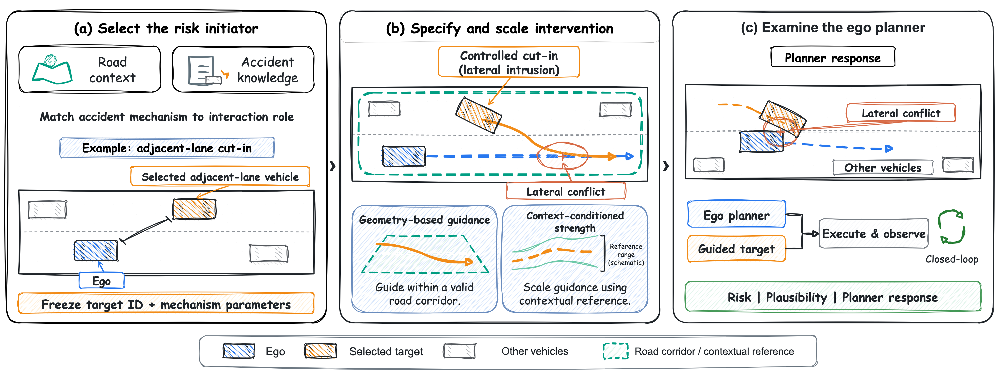
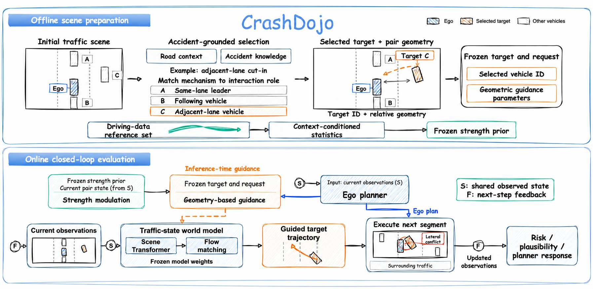

# CrashDojo

**Accident-Grounded World Models as Closed-Loop Safety Examiners for Autonomous Driving Planners**

CrashDojo maps road and participant context to an accident-informed
actor–mechanism request and steers a frozen traffic world model toward it, so
that each closed-loop planner challenge records who acts, which maneuver is
requested, and which variables are controlled.



## Framework



## Installation

The generator stack targets Linux with an NVIDIA GPU, Python 3.8, PyTorch 1.13.1
and torchvision 0.14.1.

```bash
git clone <anonymous-repository-url> CrashDojo
cd CrashDojo
conda create -n crashdojo python=3.8
conda activate crashdojo
python -m pip install 'pip<24.1'
python -m pip install -r third_party/tbsim/requirements.txt
python -m pip install -e third_party/tbsim
python -m pip install -e .
```

Install trajdata and the spline planner, and prepare the nuScenes caches, as
described in [docs/TRAINING.md](docs/TRAINING.md). The SAFE-SIM baseline ships its
own `tbsim` package; install it in a separate environment.

## Training

`scripts/train.py` launches `ccdiff/examples/train.py`:

```bash
python scripts/train.py --data /data/nuScenes --output runs/train \
  --name crashdojo_flow --gpus 4 --steps 100000 --dry-run
```

Remove `--dry-run` to start training. Use `--config trajdata_nusc_ccdiff` for the
diffusion variant, `--resume` to continue from a checkpoint, or `--smoke-steps`
for a short check.

## Evaluation and ablations

```bash
python scripts/experiment.py --list
python scripts/experiment.py --suite main_nuscenes --dry-run -- --job-id JOB_ID
python scripts/experiment.py --suite ablation_seed1 --dry-run -- --job-id JOB_ID
```

The runners need datasets, checkpoints, planner packages and request manifests.
See [docs/EVALUATION.md](docs/EVALUATION.md) and [docs/ABLATIONS.md](docs/ABLATIONS.md).

## Repository structure

```text
ccdiff/                   Generator, actor selection, mechanism guidance, planner interfaces
third_party/tbsim/        Traffic simulation framework
baselines/safe_sim/       SAFE-SIM baseline
planners/tuplan_garage/   Rule-based planner integration
configs/                  Experiment catalog and metric contract
experiments/main/         Main evaluation on nuScenes and nuPlan, baseline adapters
experiments/ablations/    Component ablations
experiments/support/      Shared runtime helpers
analysis/                 Request-realization scorer
scripts/                  Training launcher, experiment selector, runtime helpers
tests/                    Unit tests
docs/                     Training, evaluation and ablation guides
assets/                   Overview and framework figures
```

The internal package keeps the name `ccdiff` for import and checkpoint
compatibility.

## Acknowledgements

This code builds on [CCDiff](https://github.com/cruise-automation/CCDiff),
[SAFE-SIM](https://github.com/jxmmy7777/safe-sim), TBSim, trajdata and
[tuplan_garage](https://github.com/autonomousvision/tuplan_garage).

## License

Components carry different licenses; see [LICENSE](LICENSE),
[THIRD_PARTY_NOTICES.md](THIRD_PARTY_NOTICES.md) and [LICENSES/](LICENSES/).
